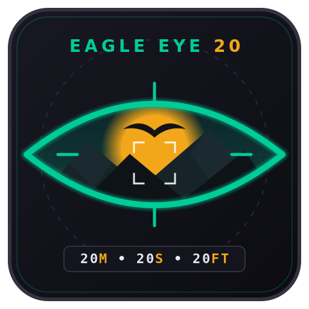

  

<h1 align="center">Eagle Eye 20/20/20 (<code>EagleEye20</code>)</h1>

  A combat-aware 20-20-20 eye strain timer for <strong>World of Warcraft 3.3.5a (Wrath of the Lich King / WoW Forever)</strong>.

Every cycle the addon counts down your screen time, then asks you to confirm you are in a safe spot before it blacks out the screen for a 20 second eye break. Because it is built for an active MMO, the break never traps you mid-pull: combat cancels the blackout, AFK pauses the clock, and flight paths offer an early break.

---

## Features

- **Timer presets** - `20/20/20` (default), `30/30/20`, `45/45/20`, `60/60/20`, or a fully **custom** scheme you define yourself (work minutes / look-away feet / rest seconds).
- **5-state engine** - running, prepare, ready gate, resting blackout, paused.
- **Safety gate** - the break only starts when you confirm; in combat the widget shows `IN COMBAT - WAITING` and holds.
- **Fullscreen blackout** with a large countdown, `LOOK X FEET AWAY` instruction, and emergency exit (double-click or `ESC`).
- **Combat interrupt** - entering combat during a break instantly restores the screen and returns to the safety gate.
- **Smart context** - pauses while AFK (auto-resets after 60s), offers a break while on a flight path with under 5 minutes left, and can auto-start inside an inn or city.
- **Event log and stats** - session and lifetime break counts, snoozes, combat interruptions, compliance rate, and a 100 entry timestamped history.
- **Party announcements** - optional start/end messages to `PARTY` (or `RAID` with the extra opt-in), with `{distance}` and `{rest}` tokens.
- **Minimap button** - the Eagle Eye icon sits on the minimap rim (left-click opens options, right-click pauses or resumes, drag to reposition, `/ee20 minimap` to hide it).
- **Flat modern UI** - no external libraries, no Blizzard dialog chrome. The logo artwork is used in the options header and the break screen.

## Installation

1. Copy the `EagleEye20` addon folder into your client's `Interface\AddOns\` directory.
2. Restart the client (or `/reload`).
3. The mini timer appears near the center of the screen; drag it where you like.

## Slash commands

All of `/ee20`, `/eagleeye20` and `/202020` work.

| Command | Action |
| --- | --- |
| `/ee20` | Open the options panel |
| `/ee20 start` | Resume (or start) the timer |
| `/ee20 pause` | Pause the timer |
| `/ee20 reset` | Reset the work timer to a full cycle |
| `/ee20 safe` or `/ee20 confirm` | Confirm you are safe and start the break |
| `/ee20 snooze [seconds]` | Push the break gate back (default 60s) |
| `/ee20 preset [20\|30\|45\|60\|custom]` | Switch the timer scheme |
| `/ee20 log` | Toggle the event log window |
| `/ee20 minimap` | Show or hide the minimap button |
| `/ee20 test` | Run a 5 second test cycle through warning, gate and blackout |
| `/ee20 help` | List commands |

## Presets

The three numbers are **work minutes / look-away feet / rest seconds**.

| Preset | Work | Look away | Rest |
| --- | --- | --- | --- |
| `20/20/20` | 20 min | 20 ft | 20 s |
| `30/30/20` | 30 min | 30 ft | 20 s |
| `45/45/20` | 45 min | 45 ft | 20 s |
| `60/60/20` | 60 min | 60 ft | 20 s |
| `CUSTOM` | 1-120 min | 1-100 ft | 5-120 s |

Both the blackout instruction (`LOOK X FEET AWAY`) and the default party messages follow the active scheme. Changing the scheme mid-cycle restarts the work timer at the new duration.

## Compatibility

- Interface `16001` (WoW Forever). Built for the client's modern API: `BackdropTemplate`
  frames, `IsInGroup`/`IsInRaid`, `Settings.RegisterCanvasLayoutCategory` options pages,
  and `UIPanelScrollFrameTemplate` scrolling. A throttled `OnUpdate` ticker drives the
  countdown, and legacy names (`strtrim`, `FauxScrollFrame*`, `math.atan2`,
  `OptionsCheckButtonTemplate`) are avoided.
- No addon dependencies, no LibStub, no Ace3.
- SavedVariables: `EagleEye20DB`.

## Planned Future Enhancements (TODO)

- **Death / Ghost State Safety Gate:** Check `UnitIsDeadOrGhost("player")` in the safety gate to display `DEAD / GHOST - WAITING` and suppress break prompts or auto-starts while dead or corpse-running.
- **Repeating Ready Alert Sound:** Add an optional repeat interval (e.g., every 30s or 60s) for the ready alert sound while holding in `READY_WAITING` out of combat.
- **SoundKit Resilient Audio Fallbacks:** Implement direct `PlaySound(SOUNDKIT_ID, "Master")` support with graceful fallbacks to `PlaySoundFile(path, "Master")`.
- **Tradeskill & Batch Crafting Detection:** Hook `UNIT_SPELLCAST_START` / `UNIT_SPELLCAST_STOP` to offer a `TAKE BREAK NOW` prompt during lengthy tradeskill crafting queues.
- **Quick Lock Toggle:** Add right-click or a small padlock toggle icon to the mini-widget to quickly lock/unlock frame position without opening the settings menu.
- **Post-Break Micro-Exercise & Posture Routine (Optional):** Optional follow-up prompt/screen displayed *after* completing the 20-second eye rest (keeping the eye break dedicated to distance recovery), guiding through light neck/shoulder stretches and blinking resets.
- **Hourly Health & Hydration Reminders:** Standalone or combined hourly prompt (every 60 minutes instead of every 20 minutes) encouraging drinking water, standing up, and posture checks.
- **Soft Dimming / Vignette Visual Mode:** An alternative visual break mode in settings that dims the screen smoothly (e.g., 70% opacity with vignette) instead of a solid blackout overlay.
- **Gamification, Streaks & Configurable Compliance Target:**
  - Configurable compliance threshold (defaults to 90%).
  - Daily & weekly compliance streak counter displayed on the minimap tooltip and log window.
  - Fun in-addon visual milestones/achievements (e.g., *Sharp Vision*, *Raid Medic*, *Marathon Gamer*).
- **Per-Character Profiles & Quick Switching:**
  - Multi-profile management (e.g., "Raiding", "Leveling", "Crafting") with fast profile switching via slash command or dropdown.
  - LibDataBroker (LDB) data feed support for display in TitanPanel, ChocolateBar, and ElvUI bars.

## License

MIT - see `LICENSE`.
